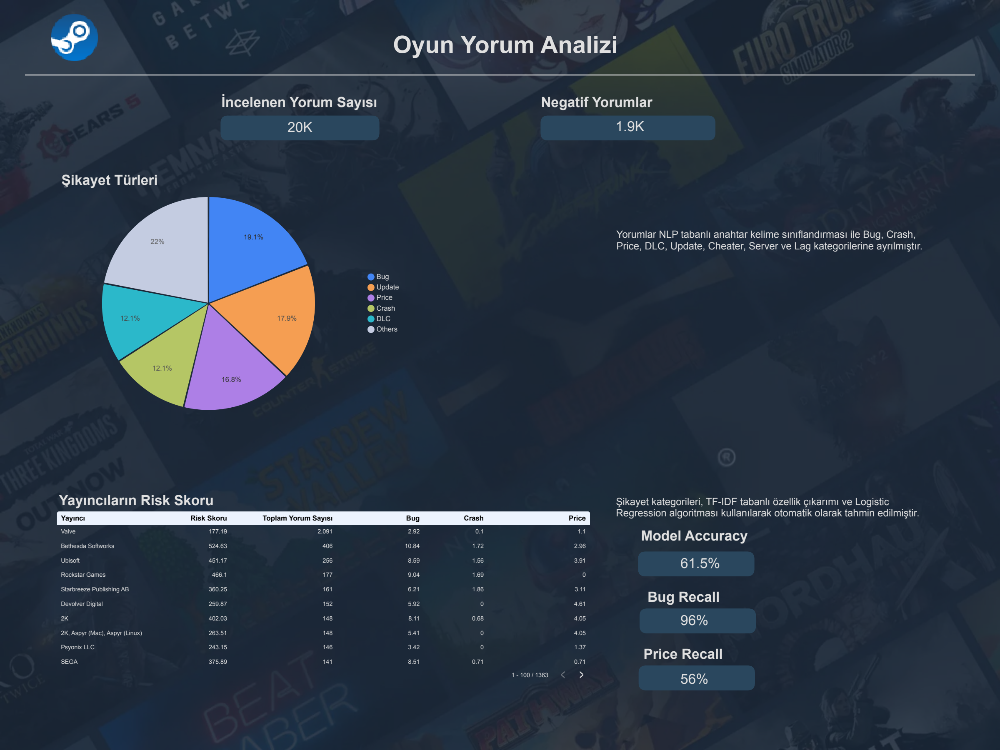

# 🎮 Steam Market & Player Review Analytics

Analysis of the Steam gaming ecosystem built on **Google BigQuery**, **dbt**, **Python** and **Looker Studio**.
This repository contains **my own contributions** to a 5-person team project:

- 📊 **Ecosystem Overview dashboard**: revenue, players, games, publishers, geography and player segments
- 💬 **Player Review Analysis (NLP)**: classifying player complaints into categories with TF-IDF + Logistic Regression
- 🧩 **Player value exploration (CLV)**: dbt feature models and exploratory analysis of player spending and engagement

> 👥 Full team project: [Steam-analysis/steam-analysis](https://github.com/Steam-analysis/steam-analysis)

---

## 👤 My Role

- **Project lead:** coordinated the team and the overall analysis scope
- **Data sourcing:** found and selected the dataset (Kaggle – Gaming Profiles, Steam subset) and loaded it into BigQuery
- **Ecosystem Overview page:** built the KPI and overview dashboard page in Looker Studio
- **Review Analysis page:** built the NLP complaint classification pipeline in Python and its dashboard page
- **dbt modeling:** staging, intermediate and mart models for player-level metrics

---

## 🏗️ Pipeline

```text
Kaggle raw data (Steam subset)
        │
        ▼
Google BigQuery (raw tables)
        │
        ▼  dbt: staging → intermediate → marts
Google BigQuery (analytics tables)
        │
        ├──► Google Colab / Python (NLP, exploration)
        │
        ▼
Looker Studio dashboard
```

---

## 📊 1. Steam Ecosystem Overview


Key figures in the dataset:

| Metric | Value |
|---|---|
| Players | ~425K |
| Games | ~98K |
| Publishers | ~51K |
| Last-year revenue (estimated) | ~$49M |

- The largest player bases are in the **USA (12.1%)**, **Brazil (10.3%)** and the **UK (6.9%)**. Türkiye accounts for 3.6%.
- Players are split into three segments by number of games owned:
  **Casual** (1–27), **Active** (28–185) and **Loyal** (186+).
  Casual and Active players are roughly equal (48% / 46%), while Loyal players make up ~6%.

---

## 💬 2. Player Review Analysis (NLP)



**Notebook:** [`notebooks/01_review_complaint_classification.ipynb`](notebooks/01_review_complaint_classification.ipynb)

### Approach
1. **Sample:** 20,000 player reviews
2. **Language filtering:** English reviews detected with `lingua` → **12,158** reviews
3. **Labeling:** rule-based keyword matching into 8 complaint categories
   (Bug, Crash, Update, Price, Server, Lag, DLC, Cheater) → **2,284** complaint reviews
4. **Model:** TF-IDF (5,000 features) + Logistic Regression, stratified 80/20 train-test split

### Results

| Metric | Value |
|---|---|
| Accuracy | 61.5% |
| Macro F1 | 0.47 |
| Bug — recall / precision | 0.96 / 0.53 |
| Price — recall / precision | 0.56 / 0.85 |

> ℹ️ The figures above come from the notebook. Some numbers in the dashboard screenshot
> (1.9K complaints, category shares) differ from the notebook results.

### Limitations & next steps
- **Labels are rule-based.** The model learns to generalize the keyword rules rather than human judgment.
  A small manually labeled validation set is the next step.
- **Class imbalance.** Bug makes up ~42% of complaints. The model tends to default to Bug,
  which explains its high recall but low precision (Lag is never predicted).
  Next step: `class_weight="balanced"` and evaluating with macro F1.

---

## 🧩 3. Player Value Exploration (CLV)

**Notebook:** [`notebooks/02_player_clv_exploration.ipynb`](notebooks/02_player_clv_exploration.ipynb)
**dbt models:** [`dbt/models/marts/`](dbt/models/marts/)

Player-level features (games owned, friends, achievements, estimated spending, account age)
are built in dbt and combined into engagement and monetary scores and segments.

> ⚠️ **Known issue (work in progress):** the price table stores price history (multiple records per game),
> so joining it directly inflates estimated spending. Fix: keep only the latest price per game
> (`row_number() ... qualify`) before the join. Segment results will be updated after this fix.

---

## 📁 Repository Structure

```text
.
├── README.md
├── images/                 # Dashboard pages
├── notebooks/
│   ├── 01_review_complaint_classification.ipynb
│   └── 02_player_clv_exploration.ipynb
└── dbt/
    ├── dbt_project.yml
    └── models/
        ├── sources/        # BigQuery source definitions
        ├── staging/        # Cleaning and type casting
        ├── intermediate/   # Player-level aggregations
        └── marts/          # Player metrics and CLV features
```

---

## 🛠️ Tech Stack

**Google BigQuery** · **dbt** · **Python** (pandas, scikit-learn, lingua, seaborn) · **Google Colab** · **Looker Studio**

---

## 📬 Contact

**Yudum Ergün** — [LinkedIn](https://www.linkedin.com/in/yudum-erg%C3%BCn/) · [GitHub](https://github.com/yudumerg)
