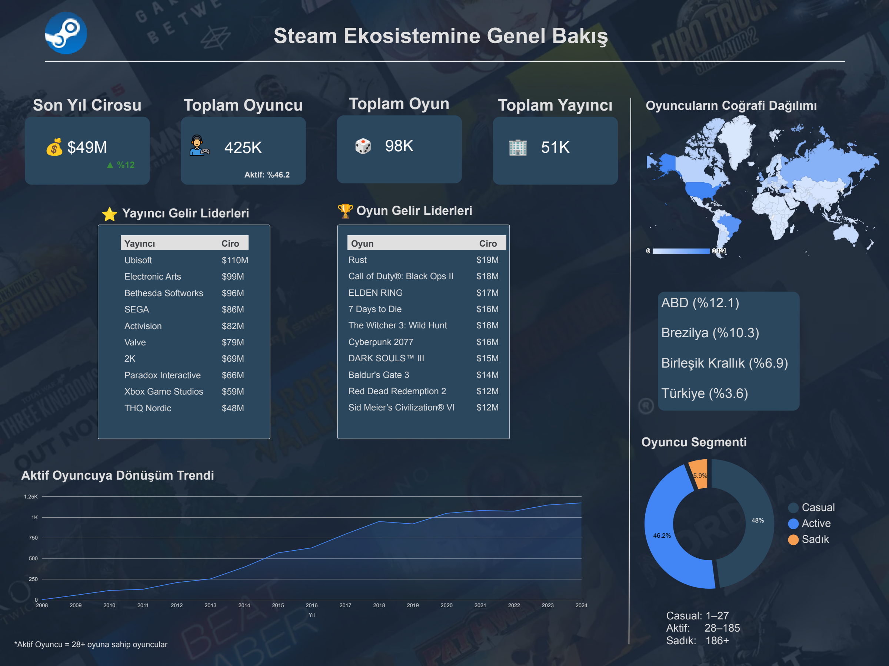
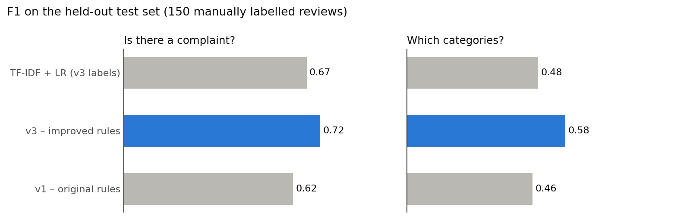
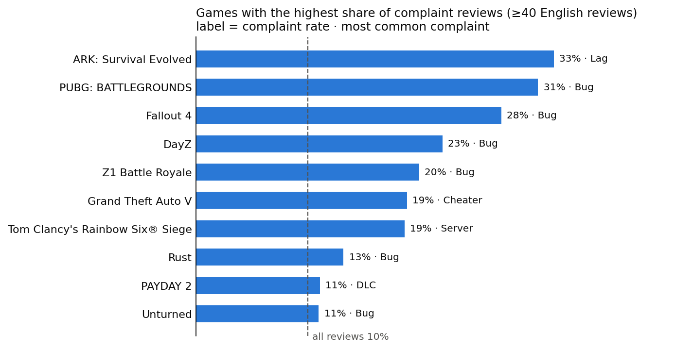

# 🎮 Steam Market & Player Review Analytics

Analysis of the Steam gaming ecosystem built on **Google BigQuery**, **dbt**, **Python** and **Looker Studio**.
This repository contains **my own contributions** to a 5-person team project:

- 📊 **Ecosystem Overview dashboard**: revenue, players, games, publishers, geography and player segments
- 💬 **Player Review Analysis (NLP)**: classifying player complaints into categories with TF-IDF + Logistic Regression
- 🧩 **Player value exploration (CLV)**: dbt feature models and exploratory analysis of player spending and engagement

> 👥 Full team project: [Steam-analysis/steam-analysis](https://github.com/Steam-analysis/steam-analysis)

---

## 👤 My Role

- **Project lead:** coordinated the team and the overall analysis scope
- **Data sourcing:** found and selected the dataset (Kaggle – Gaming Profiles, Steam subset) and loaded it into BigQuery
- **Ecosystem Overview page:** built the KPI and overview dashboard page in Looker Studio
- **Review Analysis page:** built the NLP complaint classification pipeline in Python and its dashboard page
- **dbt modeling:** staging, intermediate and mart models for player-level metrics

---

## 🏗️ Pipeline

```text
Kaggle raw data (Steam subset)
        │
        ▼
Google BigQuery (raw tables)
        │
        ▼  dbt: staging → intermediate → marts
Google BigQuery (analytics tables)
        │
        ├──► Google Colab / Python (NLP, exploration)
        │
        ▼
Looker Studio dashboard
```

---

## 📊 1. Steam Ecosystem Overview



Key figures in the dataset:

| Metric | Value |
|---|---|
| Players | ~425K |
| Games | ~98K |
| Publishers | ~51K |
| Last-year revenue (estimated) | ~$49M |

- The largest player bases are in the **USA (12.1%)**, **Brazil (10.3%)** and the **UK (6.9%)**. Türkiye accounts for 3.6%.
- Players are split into three segments by number of games owned:
  **Casual** (1–27), **Active** (28–185) and **Loyal** (186+).
  Casual and Active players are roughly equal (48% / 46%), while Loyal players make up ~6%.

---

## 💬 2. Player Review Analysis (NLP)

**Notebook:** [`notebooks/01_review_complaint_classification.ipynb`](notebooks/01_review_complaint_classification.ipynb) ·
**Rules:** [`src/complaint_rules.py`](src/complaint_rules.py)

**Question:** what do Steam players complain about, and which games get the most complaints?

### Approach
1. **Sample:** 20,000 player reviews → **11,176 English** reviews (language detection with `lingua`)
2. **Complaint rules:** 8 categories (Bug, Crash, Update, Price, Server, Lag, DLC, Cheater), multi-label,
   with whole-word matching, negation handling and VADER sentiment for ambiguous words
3. **Evaluation:** 350 manually labelled reviews – a 200-review dev set for error analysis and a
   150-review **held-out test set** never used while writing rules
4. **Model check:** TF-IDF + Logistic Regression (one-vs-rest) trained on the rule labels

### Results (held-out test set)



| Method | Complaint precision | Complaint recall | Complaint F1 | Category micro-F1 |
|---|---|---|---|---|
| v1 – original keyword rules | 0.48 | 0.85 | 0.62 | 0.46 |
| **v3 – improved rules** | **0.67** | **0.78** | **0.72** | **0.58** |
| TF-IDF + LR (trained on v3 labels) | 0.75 | 0.61 | 0.67 | 0.48 |

The model trained on rule labels does not beat the rules: it can only imitate its teacher.

### Insights



- About **10%** of English reviews contain a complaint; **Bug** appears in half of them.
- Complaint rates by publisher range from **~4–6% (Psyonix, Valve)** to **31% (KRAFTON / PUBG)**.
- The type of complaint differs by game: **Counter-Strike** → cheaters, **PAYDAY 2** → DLC,
  **Rainbow Six Siege** → servers, **ARK** → performance.

### What changed from version 1
Reviewing the first version showed three problems, and fixing them is part of this project:
- **Language filter:** the detector had English as its only candidate, so it kept 2,722 non-English reviews
  and dropped 1,740 short English ones.
- **Labels:** substring keyword matching labelled praise as complaints (*"village"* → Lag, *"no bugs"* → Bug,
  *"best update ever"* → Update).
- **Evaluation:** the model was scored against the same keyword labels it learned from, and never saw
  non-complaint reviews. Version 2 is scored against manual labels.

> ℹ️ The *Oyun Yorum Analizi* dashboard page above still shows the version 1 figures.

### Limitations & next steps
- 350 labelled reviews from one annotator; a second annotator would measure label agreement.
- Rules miss indirect complaints (*"wish the price was lower"*) and sarcasm.
- Next: train or prompt a stronger model (zero-shot / LLM) on the labelled data and compare it on the same test set.

---

## 🧩 3. Player Value Exploration (CLV)

**Notebook:** [`notebooks/02_player_clv_exploration.ipynb`](notebooks/02_player_clv_exploration.ipynb)
**dbt models:** [`dbt/models/marts/`](dbt/models/marts/)

Player-level features (games owned, friends, achievements, estimated spending, account age)
are built in dbt and combined into engagement and monetary scores and segments.

> ⚠️ **Known issue (work in progress):** the price table stores price history (multiple records per game),
> so joining it directly inflates estimated spending. Fix: keep only the latest price per game
> (`row_number() ... qualify`) before the join. Segment results will be updated after this fix.

---

## 📁 Repository Structure

```text
.
├── README.md
├── requirements.txt
├── images/                 # Dashboard pages and charts
├── data/
│   ├── README.md           # How to get the raw data
│   ├── sample_review_ids.csv
│   └── labels/             # Manually labelled dev / test sets
├── src/
│   └── complaint_rules.py  # Complaint detection rules
├── notebooks/
│   ├── 01_review_complaint_classification.ipynb
│   └── 02_player_clv_exploration.ipynb
└── dbt/
    ├── dbt_project.yml
    └── models/
        ├── sources/        # BigQuery source definitions
        ├── staging/        # Cleaning and type casting
        ├── intermediate/   # Player-level aggregations
        └── marts/          # Player metrics and CLV features
```

---

## 🛠️ Tech Stack

**Google BigQuery** · **dbt** · **Python** (pandas, scikit-learn, lingua, VADER, matplotlib) · **Google Colab** · **Looker Studio**

---

## 📬 Contact

**Yudum Ergün** — [LinkedIn](https://www.linkedin.com/in/yudum-erg%C3%BCn/) · [GitHub](https://github.com/yudumerg)
